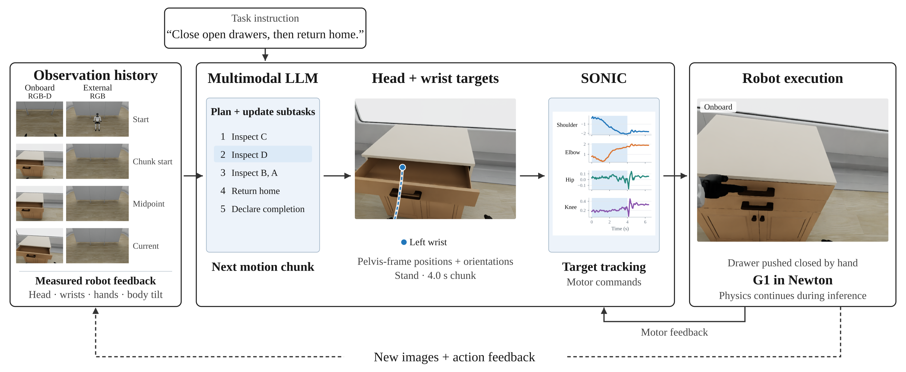
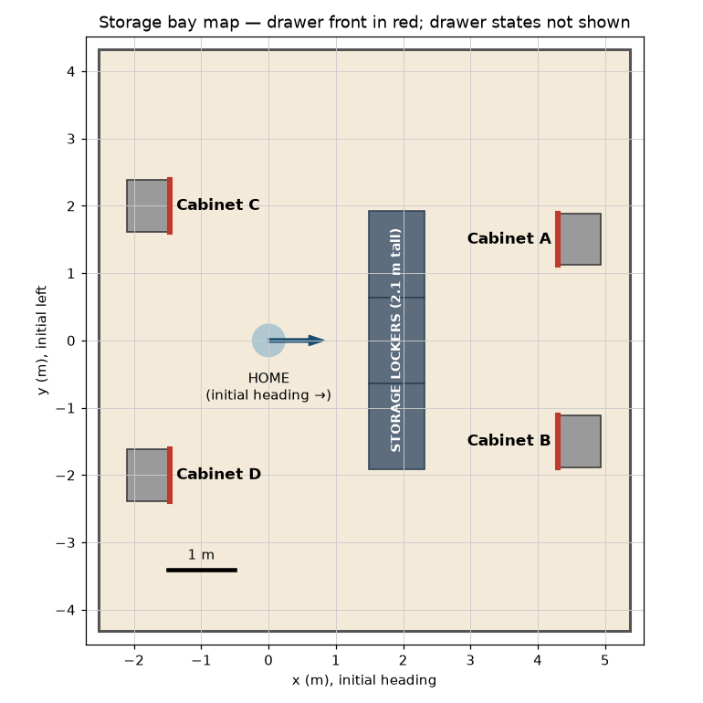

# AHOPPA

Agentic Humanoid Operation through Perception, Planning, and Action

Kingston Kuan (Hebbian Robotics), Samuel J Chew (Carnegie Mellon University),
and Brandon Ong (Hebbian Robotics)

[Project page](https://hebbian-robotics.github.io/AHOPPA/) ·
[Paper](paper/paper.pdf) · [Task](docs/storage-round.md) ·
[Reproduction](docs/reproduction.md) · [Results data](data/README.md)



AHOPPA reports results obtained in the last few weeks using frontier multimodal
model releases. These models plan inspection routes, find open drawers, push
them shut by hand and return home with a simulated Unitree G1. The model updates
a plan and generates numerical head and wrist targets with walking and posture
commands. The released SONIC controller supplies gait and balance. Physics
continues during model inference.

## Cabinet inspection task

The robot checks four cabinet drawers, closes open ones by hand, leaves closed
ones alone and returns home before declaring completion. Two cabinets are behind
tall storage lockers; two are behind the starting position. The model receives
onboard RGB-D, a fixed external RGB view, measured robot feedback and a static
facility map. Drawer positions and evaluator state are withheld.



## Initial results

The comparison has 64 scheduled episodes, four models, two reasoning settings
and eight initial drawer conditions. Each cell has one attempt, with seven
conditions starting with open drawers and one starting with all drawers closed.
GPT-6 Astra completed 12 of 14 task attempts in 615 to
1492 seconds, combining visual inspection, contact and a return home without a
task skill library. Repetitions and older-model baselines are needed to measure
reliability and capability gains.

<!-- markdownlint-disable MD013 -->

| Model | Low: success / scheduled | High: success / scheduled | API errors, low / high |
| --- | --- | --- | --- |
| GPT-6 Astra | 6/7 | 6/7 | 0 / 0 |
| GPT-6.1 Sol | 4/7 | 3/7 | 0 / 0 |
| Claude Opus 5.5 | 2/7 | 3/7 | 0 / 0 |
| Gemini 4 Argon | 0/7 | 0/7 | 3 / 2 |

<!-- markdownlint-enable MD013 -->

Every model had seven scheduled task attempts at each setting. The success
rates above include API-error starts. Gemini had three low-effort and two
high-effort API errors, plus one in the all-closed control. The chart reports
API errors separately from falls, time limits and incorrect completion claims.
All 43 drawer closures were by hand; no initially closed drawer was disturbed.

Only 17 of 58 completed episodes met the recorded 100 ms physics-lag limit;
median peak lag was 192 ms. The results include episodes that exceeded this
timing limit. Hardware performance and safety require separate experiments. See
[results and limitations](docs/results.md).


The [project page](https://hebbian-robotics.github.io/AHOPPA/) includes
synchronized onboard and external videos, requested targets, the model's plan
and the original images supplied to it. Replays are presentation derivatives;
the additional rendered frames were not model observations.

## Cost and timing

The paper and project page report estimated API cost, full episode duration
and model-decision latency for all task attempts and for successful attempts
only. Costs use recorded and provider-reconciled token usage at published
standard rates, rather than invoice amounts. Astra high was cheaper in this
sweep because more of its input used cached reads. See
[the cost and timing method](docs/api-costs.md) for definitions, evidence and
reproduction.

## Install and check the source

Use Python 3.12, uv and pnpm:

```bash
uv sync --locked
pnpm install --frozen-lockfile
uv run humanoid-agent --help
pnpm verify
```

These commands install the application and run local checks. GPU execution
additionally requires the pinned Isaac Lab/Newton environment, native SONIC
build, released G1/Dex3 assets and model API access. They are separate from the
Python installation. [Reproduction](docs/reproduction.md) lists the recorded
settings, environment requirements and the distinction between the frozen study
source and the maintained package.

## Availability and layout

- `src/humanoid_agent/`: runtime, model interfaces, evaluator and presentation.
- `configs/`: scene configurations and deployment examples.
- `tests/`: local behavior tests and separate released-asset integration checks.
- `data/`: all 64 initial episode rows and aggregate results.
- `paper/`: manuscript source and PDF.
- `web/`: project page, based on the Nerfies template.

Selected replay videos and request images are distributed as a separate media
asset. The [raw-record dataset](https://huggingface.co/datasets/hebbianrobotics/AHOPPA)
provides MCAP recordings, recorded model requests and provider responses for
exactly the 64 reported starts, with per-episode downloads and checksums.
Its dataset card documents omissions, including upstream robot descriptions.
Credentials and installed simulator environments are not included.
We train no new model for this study;
SONIC weights and simulation assets must be obtained from their upstream
releases under their own terms. See [data availability](data/README.md).

The package and command names are independent of the paper title. Historical
recording identifiers retain the earlier `webolt` prefix so evidence and shared
video identifiers remain stable.

## Licenses

Original runtime and analysis code: [MIT](LICENSE). Paper and released results:
[CC BY 4.0](https://creativecommons.org/licenses/by/4.0/). The adapted website
presentation is CC BY-SA 4.0; fonts, icons, template files and external assets
retain their own terms. See [third-party notices](THIRD_PARTY_NOTICES.md).
Hebbian Robotics logos are excluded from these content licenses.
